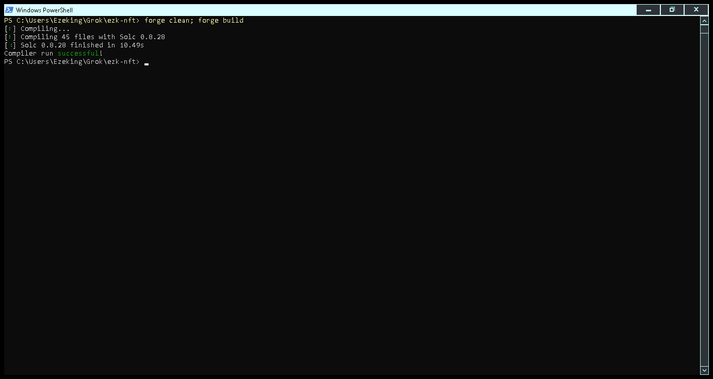
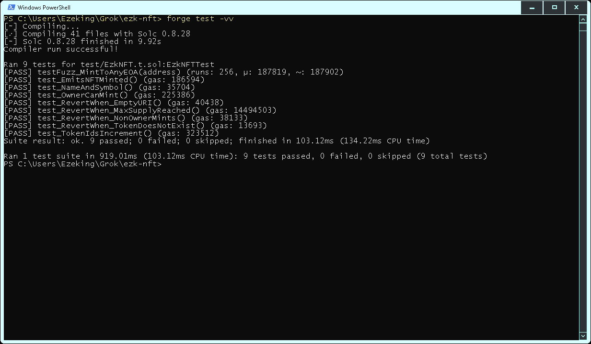
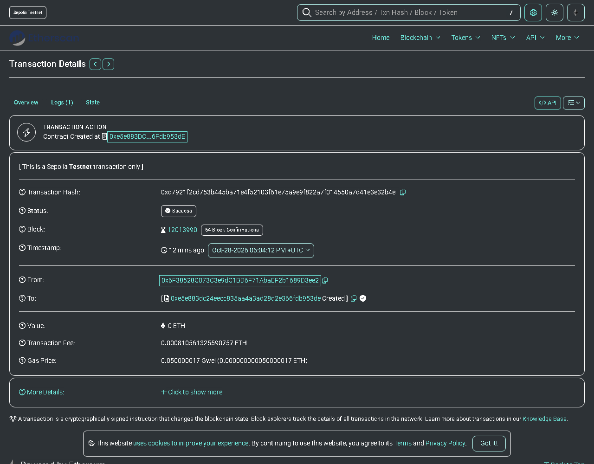
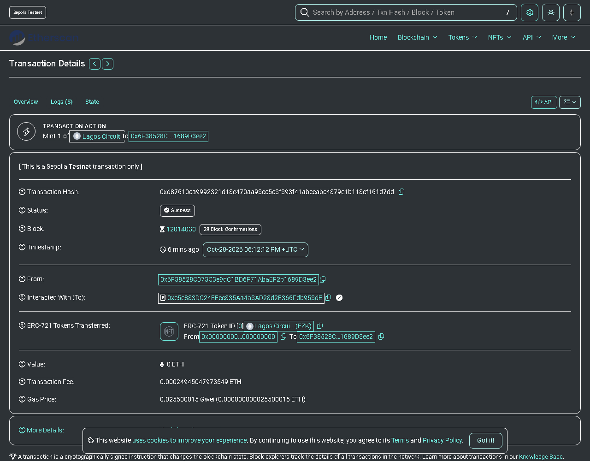
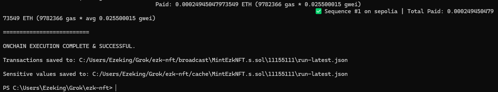
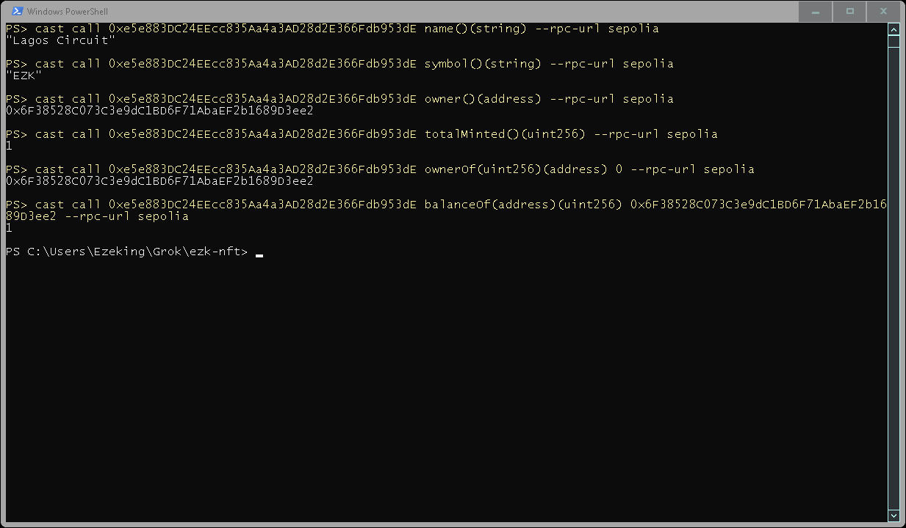

# Lagos Circuit (EZK) — ERC-721 NFT with Foundry

A customised ERC-721 NFT collection built with **Foundry**, **Solidity 0.8.28** and **OpenZeppelin Contracts v5**, deployed to the **Sepolia** Ethereum testnet.

- **Contract:** [`src/EzkNFT.sol`](src/EzkNFT.sol) — `ERC721URIStorage` + `Ownable`, owner-only `mintNFT(to, uri)`, 100-token supply cap, `NFTMinted` event
- **Tests:** [`test/EzkNFT.t.sol`](test/EzkNFT.t.sol) — 9 tests incl. a 256-run fuzz test
- **Scripts:** [`script/DeployEzkNFT.s.sol`](script/DeployEzkNFT.s.sol), [`script/MintEzkNFT.s.sol`](script/MintEzkNFT.s.sol)
- **Art:** [`nft/lagos-circuit-0.svg`](nft/lagos-circuit-0.svg) — a Lagos skyline at dusk wired into a circuit board

Token metadata can live on IPFS (Pinata) via `TOKEN_URI=ipfs://<cid>`, or — by default — be embedded fully on-chain as a base64 data URI built from the SVG in `nft/`.

## Setup

```bash
git clone --recurse-submodules <this repo>
cd ezk-nft
forge build
```

## Compile & test

```bash
forge build
forge test -vv
```

## Deploy & mint on Sepolia

1. Copy `.env.example` to `.env` and fill in `SEPOLIA_RPC_URL` (Alchemy/Infura) and `ETHERSCAN_API_KEY`.
2. Import a testnet wallet funded with Sepolia ETH into Foundry's encrypted keystore (never commit a private key):
   ```bash
   cast wallet import sepolia-dev --interactive
   ```
3. Deploy (and verify on Etherscan):
   ```bash
   source .env
   forge script script/DeployEzkNFT.s.sol --rpc-url sepolia --account sepolia-dev --sender <your-address> --broadcast --skip-simulation --verify
   ```
4. Mint, using the deployed address:
   ```bash
   NFT_ADDRESS=0x... forge script script/MintEzkNFT.s.sol --rpc-url sepolia --account sepolia-dev --sender <your-address> --broadcast --skip-simulation
   ```
   To use Pinata-hosted metadata instead, upload the image + a metadata JSON to Pinata and add `TOKEN_URI=ipfs://<metadata-cid>`.

## Local run (Anvil)

```bash
anvil
forge script script/DeployEzkNFT.s.sol --rpc-url anvil --private-key <anvil account 0 key> --broadcast
NFT_ADDRESS=0x5FbDB2315678afecb367f032d93F642f64180aa3 forge script script/MintEzkNFT.s.sol --rpc-url anvil --private-key <anvil account 0 key> --broadcast
```

## Author

Ezechi Kingsley Nnabugwu

## Live on Sepolia

| | |
|---|---|
| Contract | [`0xe5e883DC24EEcc835Aa4a3AD28d2E366Fdb953dE`](https://sepolia.etherscan.io/address/0xe5e883DC24EEcc835Aa4a3AD28d2E366Fdb953dE) |
| Deploy tx | [`0xd7921f2c…e32b4e`](https://sepolia.etherscan.io/tx/0xd7921f2cd753b445ba71e4f52103f61e75a9e9f822a7f014550a7d41e3e32b4e) |
| Mint tx (token #0) | [`0xd87610ca…161d7dd`](https://sepolia.etherscan.io/tx/0xd87610ca9992321d18e470aa93cc5c3f393f41abceabc4879e1b118cf161d7dd) |

Sepolia charges far more gas for contract creation and on-chain storage than Foundry's local simulation predicts, so pass `--skip-simulation` to use the network's own gas estimate.

## Screenshots

| Step | |
|---|---|
| Compilation |  |
| Testing |  |
| Deployment |  |
| Minting |  |
| Minting (terminal) |  |
| On-chain check |  |
